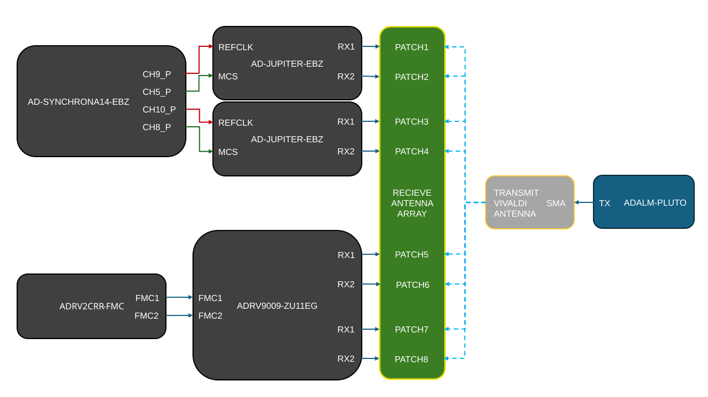

.. collection:: Scalable Phased Array and Adaptive RF Systems
   :subtitle: SDR system development enabled by ADI DataX.
   :image: demo-block-diagram.svg
   :label: demo

   Explore scalable RF platforms and a monopulse tracking application.

   system-level:
     - .
     - tools/pluto/index
     - learning/workshop_what_sw_for_sdr/index

.. _monopulse-tracker:

Scalable Phased Array & Adaptive RF Systems Enabled by ADI DataX™
================================================================================

Complex RF needs a faster path from idea to array. ADI DataX accelerates
Software Defined Radio (SDR) systems-based development by simplifying evaluation
across platforms like ADALM-PHASER, Jupiter SDR, and Talise SOM. These platforms
support synchronized MIMO scaling and rapid prototyping for complex RF
architectures. Designers can use various abstraction layers that streamline data
acquisition and system optimization. This unified workflow speeds the creation
of adaptive, high-performance RF solutions.

Resources
--------------------------------------------------------------------------------

- Holohub:
  :git-holohub:`Jupiter Holohub Project <afpop/jupiter_monopulse_tracker:applications/jupiter_monopulse_tracker>`
- Matlab:
  :git-TransceiverToolbox:`Talise Matlab Project <master:trx_examples/streaming/adrv9009/ADRV9009ZU11EG_Monopulse_Tracking_Example.m>`
- Hardware:

  - :adi:`AD-SYNCHRONA14-EBZ <ad-synchrona14-ebz>`
    (:ref:`user guide <ad-syncrhona14-ebz>`)
  - :adi:`AD-JUPITER-EBZ <ad-jupiter-ebz>`
    (:ref:`user guide <ad-jupiter-ebz>`)
  - :adi:`ADRV9009-ZU11EG RF-SOM <adrv9009-zu11eg>`
    (:ref:`user guide <adrv9009-zu11eg>`)
  - :adi:`ADRV2CRR-FMC <adrv2crr-fmc>`
  - :adi:`ADALM-PLUTO <adalm-pluto>` (:ref:`user guide <pluto>`)

Required Software
--------------------------------------------------------------------------------

- :git-holohub:`Holohub <tree/main+>`
- :mw:`Matlab <products/matlab.html>`

  - With :git-TransceiverToolbox:`Transceiver Toolbox <master:/>` add-on
    installed using the add-on explorer in Matlab.

Block diagram
--------------------------------------------------------------------------------

   Demo Block Diagram

Demo description
--------------------------------------------------------------------------------

This demo illustrates the implementation of a monopulse tracking system using
ADI's DataX™, showcasing the platform independence and scalability of our
systems. The demo consists of two main systems: the transmitter and the receiver
system.

The transmitter system is using an :adi:`ADALM-PLUTO <adalm-pluto>` to
generate an RF signal, which is then transmitted through a wideband Vivaldi
antenna.

The receiver system uses two separate platforms to showcase the capabilities
of DataX™, and the ease of scaling and prototyping across different platforms.

The first receiver system is based on the
:adi:`AD-JUPITER-EBZ <ad-jupiter-ebz>`, which is a versatile software-defined
platform based on :adi:`ADRV9002 <adrv9002>` and AMD Xilinx Zynq UltraScale+
MPSoC. ADRV9002 is a new generation RF transceiver that has dual-channel
transmitters, dual-channel receivers covering 30 MHz to 6 GHz frequency range
with very good RF linearity performance and a set of advanced features like fast
profiles switching, flexible power vs performance configuration, fast frequency
hopping, multi-chip synchronization and DPD for narrow and wide band waveform.
This demo heavily depends on the multi-chip synchronization (MCS) capabilities
of the ADRV9002, which allows the usage of two
:adi:`AD-JUPITER-EBZ <ad-jupiter-ebz>`, synchronized using the
:adi:`AD-SYNCHRONA14-EBZ <ad-synchrona14-ebz>` to create a 4-channel receiver
system.

The second receiver system is based on the
:adi:`ADRV9009-ZU11EG RF-SOM <adrv9009-zu11eg>`, a highly integrated RF
System-On-Module (RF-SOM) based on the :adi:`ADRV9009 <adrv9009>` and AMD Xilinx
Zynq UltraScale+ MPSoC. The RF-SOM is a platform for evaluation and
prototyping. To use the RF-SOM a carrier board is required, the
:adi:`ADRV2CRR-FMC <adrv2crr-fmc>` board is designed for this purpose.

As for the software, the demo is implemented using Holohub and Matlab. Both
applications run on a host computer and stream the data from the hardware over
the network: the Holohub implementation controls the Jupiter platforms, while
the Matlab implementation controls the RF-SOM platform. Both implementations are
using DataX™, which allows for easy prototyping and scaling across different
platforms.

But what is Monopulse Tracking?
--------------------------------------------------------------------------------

The name refers to its ability to extract range and direction from a single
signal pulse.
The method uses two simultaneous beams, the **SUM** and **DELTA** beams, to
compare the received signal's amplitude and phase, enabling precise angle
estimation. This technique is widely used in radar and communication systems for
accurate target tracking and direction finding.

.. figure:: monopulse-visual.png
   :align: center

   Monopulse Tracking Concept

The **SUM** beam captures the total signal strength, while the **DELTA** beam
measures the difference in signal strength between the two halves of the antenna
array. The **SUM** beam has a maximum when pointed directly towards the
transmitter, while the **DELTA** beam can be:

- Δ ≈ 0, when the signal arrives from mechanical boresight
- Δ > 0, when the signal arrives from the left of the mechanical boresight
- Δ < 0, when the signal arrives from the right of the mechanical boresight

Correlating the **SUM** and **DELTA** beams results in an error, which is the
difference between the actual angle of arrival and the electrical boresight. By
calculating the phase of this error signal, the system can estimate
the angle of arrival of the incoming signal with high precision, even in
environments with significant noise and interference.

After the angle of arrival is estimated, the phased array can be electrically
steered to point towards the transmitter, by adjusting the phase of the signals
received by each antenna element.

.. important::

   The monopulse tracking technique is extremely sensitive to the phase and
   amplitude balance of the antenna array, as well as the calibration of the
   system. Any imbalance or miscalibration can lead to errors in the angle of
   arrival estimation, which can degrade the performance of the tracking system.

   Before doing the monopulse tracking, it is important to calibrate the system
   and make sure that you are using a well balanced antenna array.

Required Hardware
--------------------------------------------------------------------------------

.. csv-table::
   :file: hardware-table.csv
   :header-rows: 1

SD Card Configuration
--------------------------------------------------------------------------------

- For the :adi:`ADRV9009-ZU11EG RF-SOM <adrv9009-zu11eg>` platform, write the
  Kuiper image to an SD card, as described at
  :external+kuiper:ref:`use-kuiper-image-writing`, and copy the
  ADRV9009-ZU11EG boot files to the boot partition, as described at
  :external+kuiper:ref:`hardware-configuration-adi-eval-boards`.

- For the :adi:`AD-JUPITER-EBZ <ad-jupiter-ebz>` platform, begin by writing the
  image to an SD card the same way as for the ADRV9009-ZU11EG, then copy the
  files from the following zip to the boot partition of the SD card:

  :download:`jupiter-mcs-sync.zip`

- For the :adi:`AD-SYNCHRONA14-EBZ <ad-synchrona14-ebz>`, the SD card should be
  flashed as before and the device tree overlay from the following zip should
  be copied to the ``overlays`` directory of the boot partition of the SD card:

  :download:`synchrona-jupiter-mcs.zip`

  Then, load the ``rpi-ad9545-hmc7044`` overlay as described at
  :external+kuiper:ref:`hardware-configuration-raspberry-pi`.

- Lastly, for the :adi:`ADALM-PLUTO <adalm-pluto>`, the firmware should be
  updated, as described at :ref:`pluto-m2k firmware`.
  The demo transmits at 5.4 GHz, which is outside of the default tuning range
  of the ADALM-PLUTO (325 MHz to 3.8 GHz), so the device must be configured in
  AD9364 mode, as described at :ref:`pluto users customizing`.
  Then, the files from the following zip should be copied to a flash drive:

  :download:`pluto-script.zip`

  For additional information please visit :ref:`pluto devs usb_otg`.

Results
--------------------------------------------------------------------------------

Here are presented the plotted results of the demo. On the X axis the angle of
arrival is presented, while on the Y axis the time is presented, to make a
waterfall type of plot.

.. figure:: results-holoscan.png
   :align: center

   Holohub implementation results

.. figure:: results-matlab.png
   :align: center

   Matlab implementation results
