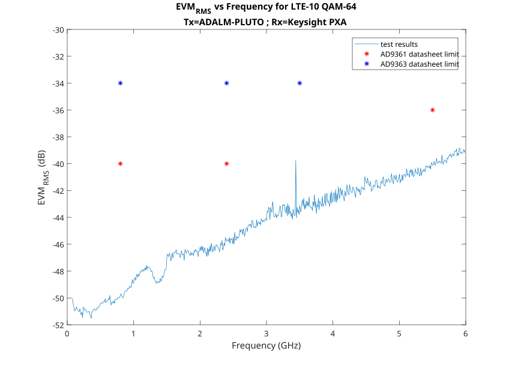

.. _pluto users receive:

ADALM-PLUTO Receive
===================

Receive Architecture
--------------------

The AD9363 receive chain is based on
`Direct Conversion <https://en.wikipedia.org/wiki/Direct-conversion_receiver>`_
technique. Although this block diagram is for the :adi:`AD9361`, it is also
appropriate for the :adi:`AD9363` found inside the ADALM-PLUTO. The difference
between the two units is the tuning range, a minor missing features (DCXO,
external LO are missing and the RF channel bandwidth is reduced).

.. figure:: images/receive/ad9361.svg

* AGC is good. Please use it.

  * AGC needs to be set up properly so that it is good, defaults are just that -
    a best guess for generic waveforms.

* Half bands and FIR is there, you should use those.

  * The best performance is normally running the ADC as fast as possible, and
    decimating as much as possible.

Receive Performance
-------------------

Details on the performance can be found in the
:ref:`performance section <pluto devs performance>`.

While there are many aspects of receive performance, the two most common are:

* `Receiver sensitivity <https://en.wikipedia.org/wiki/Sensitivity_(electronics)>`_
  (how far away can I be, and still receive something).
  :ref:`Separate Topic <pluto users receiver_sensitivity>`.

* Input fidelity (how accurate is the reception)

For the ADALM-PLUTO, both the receiver sensitivity and input accuracy are
frequency dependent. For plots vs frequency, check out the detailed
:ref:`performance section <pluto devs performance>`.

This is the output of the
`Keysight 89600 VSA software <http://www.keysight.com/find/89600B>`_, which is
used to measure signal demodulation and complete vector signal analysis. In this
case, we generate an LTE 10 (10MHz wide channel), and transmit it out the Tx
port of the
`E4438C ESG Vector Signal Generator <https://www.keysight.com/en/pd-1000004297%3Aepsg%3Apro/esg-vector-signal-generator>`_
and capture it on the ADALM-PLUTO's Rx port, and then save the data, and load it
into the VSA software for analysis. We can measure the RF offset (frequency
error = 67Hz), and how accurate the 64-QAM constellation is created (an EVM of
-43 dB, or less than 0.6% RMS error) - which is pretty good (better than the
AD9363 datasheet).

.. figure:: images/receive/rev_b_rx_lte10.png
   :width: 800

By changing the LO frequency, output power, output attenuation, these results
will change.

