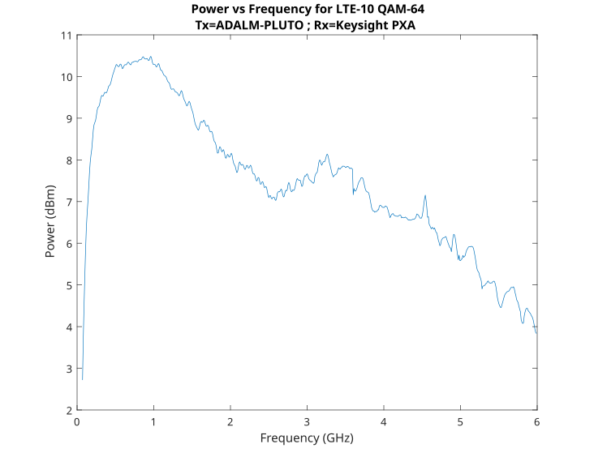

.. _pluto users transmit:

ADALM-PLUTO Transmit
====================

Transmit Architecture
---------------------

The AD9363 transmit chain is based on Direct Conversion techniques.

.. figure:: images/transmit/ad9361.svg

The Tx LO maintains constant amplitude, so optimal Signal-to-LO ratio requires
running DACs near full scale, then adjusting output attenuation to control
signal strength rather than reducing DAC input. Full scale into the DAC is 12
bits, though the HDL from ADI requires a 16-bit signal with lower 4 LSBs
removed.

Transmit Performance
--------------------

Two primary performance aspects are output power (transmission range) and output
fidelity (transmission accuracy). Both are frequency dependent for the
ADALM-PLUTO.

Transmit Power
~~~~~~~~~~~~~~

Most modern spectrum analyzers allow measurement of power within a frequency
range called the channel bandwidth. Such analyzers make many small power
measurements :math:`p_i` across a frequency range. They average these power
measurements to calculate a desired channel power over a desired frequency
range using the following equation:

.. math::

   P_{CH} = \frac{B_S}{B_N} \cdot \frac{1}{N} \sum_{i=n_1}^{n_2} 10^{p_i/10}

Where :math:`P_{CH}` is the power in the channel, :math:`B_S` is the specified
bandwidth (also known as the channel bandwidth), :math:`B_N` is the equivalent
noise bandwidth of the resolution bandwidth (RBW) used, :math:`N` is the
number of data points in the summation, :math:`p_i` is the sample of the
power in measurement :math:`i` in dB units (if :math:`p_i` is in dBm,
:math:`P_{CH}` is in milliwatts). :math:`n_1` and :math:`n_2` are the
end-points for the index :math:`i` within the channel bandwidth, thus
:math:`N = (n_2 - n_1) + 1` [3]_.

For this test an LTE10 signal was transmitted at various LO frequencies, and
the power in the 9 MHz channel was measured and recorded:

   LTE10 Power in channel

This differs from a continuous sine wave (CW) at various LOs, where the LO
was swept from 70 MHz to 6 GHz. This is not measuring power in the channel,
just peak transmit power (the spectrum analyzer was set up to do a peak
hold). The two graphs show the difference between the Tx attenuation
settings. The default setting of -10dB ensures that the analog output stages
are running completely in the linear range, and will not saturate or come
close to the 1dB compression point. It is also safe at this setting to loop
the Tx directly into the Rx with an SMA cable.

.. warning::

   Do not set the TX attenuation to anything less than -10dB and loop the Tx
   (output) signal into the Rx (input) connector.

However, using the AD9361 or any SDR should be calibrated before attempting
any measurement in absolute units. This is necessary since data that is
provided from the AD9361 is in reference to the full scale range of the ADC
which is dependent on the gain stages of the transceiver. The values
produced are therefore best described in dBFS or ADC codes, and not dBm or
volts.

.. figure:: images/transmit/txat0.png
   :width: 420

   CW at 0dB attenuation

.. figure:: images/transmit/txat-10.png
   :width: 420

   CW at -10dB attenuation

The random peaks in the -10 dB attenuation settings are (likely) random
noise caused by the Tx calibrations when the LO changes by more than 100 MHz.

As expected, the wider LTE10 channel measurement has more *power* in it than
a narrow CW signal.

Transmit Fidelity
~~~~~~~~~~~~~~~~~

This is the output of the `Keysight 89600 VSA software
<http://www.keysight.com/find/89600B>`__, which is used to measure signal
demodulation and complete vector signal analysis. In this case, we generate
an LTE 10 (10MHz wide channel), and transmit it out the Tx port of the
ADALM-PLUTO, and capture it on the `PXA N9030A Signal Analyzer
<http://www.keysight.com/find/N9030A>`__. We can measure the RF offset
(frequency error = 50Hz), and how accurate the 64-QAM constellation is
created (an EVM of -46dB, or less than 0.5% RMS error) -- which is pretty
good. We can also see the output power (average peak output for the 10MHz
channel is -45dBm/Hz).

.. figure:: images/transmit/rev_b_tx_lte10.png
   :width: 800

By changing the LO frequency, output power, output attenuation, these
results will change.

.. figure:: images/transmit/pluto_tx2.svg
   :width: 800

.. important::

   This is power out the SMA, not the antenna. Any antenna (including the
   one provided in the kit) may provide additional filtering (change the
   shape), as well as gain/attenuation.

This test was done in an open lab setting and as a result we can observe
degradation at certain common commercial frequencies like LTE and WiFi. To
remove these outliers the tests should be run inside an RF chamber, to make
sure there is no external noise, but since we meet datasheet specifications,
we are unlikely to.

.. [3] https://literature.cdn.keysight.com/litweb/pdf/5966-4008E.pdf